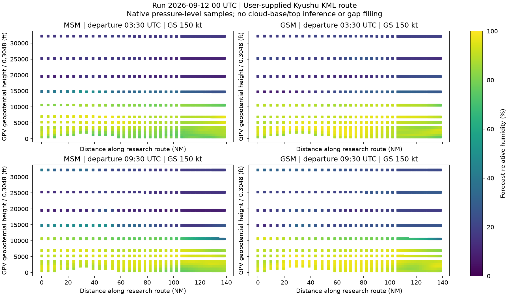

# WX Route Profile: 雲・湿度の技術検証（#374）

**結論：気圧面の相対湿度と層別雲量は追加取得できる。ただし、今回の資料・実データだけでは雲底・雲頂を信頼できる精度で推定できない。**
後続では、相対湿度の疎な鉛直分布と、全・下・中・上層雲量を別々に扱うことを提案する。
RHの閾値を雲の有無・確率へ変換する方式は採用しない。

[Issue #374 雲・湿度の技術検証](https://github.com/Yuto-24/NavMate/issues/374)の調査結果。
2026-11-09に、`jma-gpv-weather 0.6.0`、NavMate `d3b2b422` と公開GRIBで確認した。
本番機能・配信・UIの変更はない。測定はLinux上で行い、iPhone/iPad Safariの実機受入は未実施。
単一Runの比較であり、観測との精度検証や季節・気象事例をまたぐ校正ではない。

## GPVの要素・範囲

一次資料は、気象庁の[MSM仕様 No.12601（2022-06-16改訂）](https://www.data.jma.go.jp/suishin/shiyou/pdf/no12601)と
[GSM仕様 No.12501（2023-03-14改訂、日本域の別紙2・4）](https://www.data.jma.go.jp/suishin/shiyou/pdf/no12501)。
[技術情報645（2025年）](https://www.data.jma.go.jp/suishin/jyouhou/pdf/645.pdf)は、アジア域・高解像度全球域の追加によって日本域の仕様を変更しないと明記している。
GSM全球域のレベル・時間間隔を日本域へ流用しない。

| 項目 | MSM日本域 | GSM日本域 `Rjp_Gll0p1deg` |
| --- | --- | --- |
| 領域 | 北緯22.4–47.6、東経120–150 | 北緯20–50、東経120–150 |
| 地上格子 | 緯度0.05°×経度0.0625°、505×481 | 緯度0.1°×経度0.125°、301×241 |
| 気圧面格子 | 緯度0.1°×経度0.125°、253×241 | 緯度0.1°×経度0.125°、301×241 |
| Run | 3時間毎。00/12 UTCは78時間、他は39時間先まで | 6時間毎。00/12 UTCは264時間、06/18 UTCは132時間先まで |
| 時間間隔 | 地上1時間、気圧面3時間 | 132時間先まで地上1時間・気圧面3時間。その後は地上3時間・気圧面6時間 |
| RHの気圧面 | 両モデルとも1000, 975, 950, 925, 900, 850, 800, 700, 600, 500, 400, 300 hPaの12面 | 同左 |
| HGT・風・気温 | 上記12面と250, 200, 150, 100 hPa | 同左 |
| 雲量 | 全・下・中・上層の4要素。鉛直の各気圧面の雲量ではない | 同左 |

実ファイルの全メッセージを走査し、要素・レベル・時刻・格子数を
[results.json](evidence/issue-374/results.json)の`inventory`へ保存した。
MSMはFH00–15、GSMはFH00–24の地上・気圧面各1ファイル。上表の長期予報末尾を全取得したわけではなく、末尾・領域の仕様は一次資料に基づく。
GRIBではRHがcategory 1 / number 1、HGTが3 / 5、雲量が6 / 1,3,4,5、地上気圧が3 / 0だった。
`pygrib 2.1.8`では全雲量のshortNameとunitsが`unknown`となるため、文字列名だけで選別せず、JMA仕様のパラメータ番号で識別する（雲量の単位は%）。

高度軸には同一地点・時刻のHGTを使う。標準大気で850 hPaを固定のftへ置換しない。
HGTのGRIB単位はgpm（ジオポテンシャル高度）。試作図は`HGT / 0.3048`をft表示しており、幾何高度や機上の気圧高度との一致を保証しない。

## 雲量と相対湿度から分かること

気象庁の[数値予報研修テキスト第49巻・付録C](https://www.jma.go.jp/jma/kishou/books/nwptext/49/Appendix_C.pdf)は、
層別雲量がモデル面の雲量を重なりの仮定で集約した値であることを説明している。
2016年時点の算出説明では、MSMは地上気圧を用いた層境界、GSMはモデル鉛直層の境界を用いる。
これを現在の固定MSL高度帯や個別の雲底・雲頂と解釈しない。図にも雲量から作った高度境界を描いていない。
この歴史的説明だけで2026年の雲スキーム詳細が不変とは断定しない。

同資料のRHには温度に応じた水・氷の飽和水蒸気量が関わる。一定のRHを「雲の存在確率」として読み替える根拠はない。
高RHが続く面は湿潤層の候補を示せるが、雲粒の有無・層内の充填率・雲の連続性は確定しない。
地上に近い雲は最下位の有効気圧面より下にあり得るし、上層雲はRHの最上位300 hPaより上にもあり得る。
薄い層は気圧面の間に収まり、観測できない。上層雲量が0でないことは、300 hPa以上のRHを補完する根拠にもならない。

## 指定KML経路による実データ比較

ユーザー指定KMLの5座標を順序どおり使った。高度値0は飛行高度に採用しない。
座標は下記の緯度・経度順。空港DBへの置換や経路の短縮は行っていない。

| 点 | 緯度 | 経度 |
| --- | --- | --- |
| 1 | 31.87712037682015 | 131.4484495960596 |
| 2 | 32.11563297766774 | 130.3376632947516 |
| 3 | 32.89351014087774 | 130.5367556500529 |
| 4 | 32.85783487963734 | 130.0867842334102 |
| 5 | 32.91714519596533 | 129.9132553497481 |

- Run：両モデルとも2026-09-12 00:00 UTC。既存fixtureと同じ日の取得可能な過去事例を固定した。最新予報の評価ではない。
- 出発：03:30 / 09:30 UTC。GS 150 ktで累積距離から通過時刻を求める。計算済みNAV LOGのETOではない。
- 各Legを緯度経度上で12等分、共有端点を重複させず49地点。距離は各小区間の球面距離の合計138.361 NM。到着は04:25:20.673 / 10:25:20.673 UTC。
- 水平は4格子点の双線形補間、時刻は規定の隣接予報時刻で線形補間。RH・HGTは3時間、地上気圧・雲量は1時間。モデル・Runは混在させない。
- 鉛直方向は12気圧面の値をそのHGT上に置く。隣接高度の間を雲で塗りつぶす補間はしない。
- 地上気圧より高圧の面はモデル地表下として除外。これはDEMや地形余裕の計算ではない。地表付近の4格子点それぞれに対する地形混合の精査も未実施。
- 必要な時刻・面・格子値が欠けたら未取得値として残す。遠い時刻や次の有効高度で穴を埋めない。

色はRHであり、雲量・雲の存在確率ではない。空白は雲のない空域を意味しない。
[profile.csv](evidence/issue-374/profile.csv)に全2,352サンプルの位置・通過時刻・気圧面・HGT・RH・層別雲量・状態を保存した。
モデル地表下も元値を監査用に残すが、`state=below_model_surface`は描画・集計から除外する。

### 閾値・モデル・時刻への感度

以下は有効な「地点×気圧面」の個数であり、体積率・雲量・確率ではない。
80/90/95%は閾値感度の試験値で、気象学的に校正した雲判定ではない。

| モデル / 出発UTC | 有効セル | RH≥80% | RH≥90% | RH≥95% |
| --- | ---: | ---: | ---: | ---: |
| MSM 03:30 | 577 | 306 | 85 | 18 |
| MSM 09:30 | 577 | 330 | 198 | 23 |
| GSM 03:30 | 574 | 365 | 204 | 76 |
| GSM 09:30 | 574 | 342 | 230 | 94 |

始点のMSM 03:30では、80%なら1000–700 hPaの8面（約555–10,591 ft）が該当する。
90%では975・950・850・800 hPaの4面だけになり、間の925・900 hPaは該当しない。95%では該当面がない。
この値を雲底・雲頂とすると、任意の閾値で高度・連続性・雲の有無が変わる。
同地点09:30の90%では1000・975・950・925・800 hPaとなり、時刻によっても変わる。

03:30の全雲量は経路上でMSM約28–72%、GSM約49–89%。RH≥90%のセル数は85対204であり、
両者を同じ物理量として扱えない。モデル差も相互の正解を判定する材料ではない。
今回、収録範囲内の欠測は0件だった。モデル地表下は2出発合計でMSM22件、GSM28件。
250 hPa以上にはRHそのものがなく、300 hPaより上は対応外として扱う。
実欠測事例の代わりに、検証コードのテストで欠けた時刻・面・NaN格子・領域外を注入し、補間しないことを確認した。

観測の雲底・雲頂との照合は行っていない。したがって誤差幅、的中率、雲底を数百ft単位で推定できるといった精度主張はできない。
本Issueの「成立しない場合は代替表現を報告する」条件に従い、湿度断面と層別雲量を分ける結論とする。

## 追加データ量と端末資源

### 実測条件

実ファイル4個、合計184,591,261 bytesを一時領域に取得した。URL・サイズ・SHA-256は結果JSONにある。
現行既定領域にライブラリと同じ補間用余白を加え、北緯29.59–35.31、東経128.37–134.93を切り出した。
気圧面は58×53、MSM地上は115×105、GSM地上は58×53点。
00–12 UTCの13時間端点・5気圧面時刻を使い、float64・NPZ/DEFLATEで比較した。

既存データは0.6.0のデコーダとpublic `MsmPreparedData` / `GsmPreparedData.to_bytes()`を使用。
追加試作はRH12面＋HGT12面＋地上気圧＋4雲量。独立取得を見積もるため、HGT・地上気圧・座標の重複を含む。
追加NPZは**研究用の仮形式**で、現行portable schemaの互換payloadではない。

| モデル / データ | 圧縮MiB | 展開配列MiB | Linux読込ms | 読込前RSS / peak RSS MiB |
| --- | ---: | ---: | ---: | ---: |
| MSM 既存 | 2.607 | 12.123 | 49.6 | 26.0 / 42.25 |
| MSM 追加試作 | 1.788 | 9.041 | 32.5 | 25.75 / 38.0 |
| GSM 既存 | 1.867 | 9.450 | 44.5 | 25.75 / 38.75 |
| GSM 追加試作 | 0.966 | 4.440 | 24.2 | 25.75 / 32.75 |

読込はNumPy import後の独立Linuxプロセスで1回、ファイル読込＋NPZ全配列展開を測定。
RSSは`/proc/self/status`のVmRSS/VmHWM。producer親プロセスのhigh-water markを持ち越し得る`ru_maxrss`は使わない。
ブラウザー転送、Pyodide起動、library検証・query、描画は計時対象外。速度・RSSは再実行で変動する。
既存＋追加の両方を保持する場合、配列だけでMSM約21.16 MiB、GSM約13.89 MiBとなる。
転送コピーを追加圧縮データの3倍、展開の一時コピーを追加配列の1倍と仮定すると、追加メモリはMSM約23.45 MiB、GSM約11.78 MiB。
これは`3×圧縮 + 2×展開配列`の概算であり、WASM heap・Python object・アプリ本体を含む総RAM上限ではない。

### Feed / cacheの予算

現行制限は[payload catalog](../src/autonavlog/weather/local_msm.py)の32 MiBと
[モデル別Cache Storage](../web/src/localWeather.ts)の128 MiB。
さらに0.6.0のportable decoderには、ZIP展開合計128 MiB・member数2,048・各member32 MiB・metadata1 MiBという独立した制限がある。
圧縮サイズだけで成立性を判定しない。

同じ格子とfloat64で時間数を伸ばした概算は次のとおり。圧縮量は今回の圧縮率を仮定しており、実測した長期ファイルの値ではない。
member数は現行の「変数×面×時刻ごとに1配列」と共有座標4枚＋metadata1個で算出する。

| モデル / horizon | 追加圧縮MiB（概算） | 追加配列MiB（概算） | 追加のみmembers | 既存と統合・重複除去後のmembers |
| --- | ---: | ---: | ---: | ---: |
| MSM 39h | 5.25 | 26.54 | 541 | 1,161 |
| MSM 78h | 10.24 | 51.82 | 1,048 | 2,253 |
| GSM 78h | 5.34 | 24.56 | 1,048 | 2,847 |
| GSM 132h | 8.93 | 41.02 | 1,750 | 4,755 |
| GSM 264h | 12.75 | 58.56 | 2,498 | 6,867 |

式は、気圧面時刻数をP、地上時刻数をSとして、追加record数=`24P+5S`。
既存と同一NPZに統合する場合はHGTと地上気圧の重複を除き、MSMは`54P+10S+5`、GSMは`76P+10S+5` membersとなる。
追加bytesは`24P×気圧面格子数×8 + 5S×地上格子数×8 + 共有座標`。
GSMは132h以降の6h/3h間隔を適用した。member数にはmetadataを含み、配列量の長期概算にはmetadataやZIPヘッダーを含めない。

MSM 78hは、既存＋独立WXの圧縮合計推定が約25.13 MiBで32 MiB以内でも、1つのNPZに統合すると重複を除いてもmember数制限を超える。
GSM 264hは追加だけでも超える。既存schemaのままキーを増やす案は不適合。
現行record構造をGSM長期windowへ外挿すると既存分だけでもmember数制限が問題になるが、これは今回の概算であり、全予報期間の本番障害を再現したという主張ではない。

MSM 78hを既存＋追加で3 Run保持する概算は約75.4 MiB。128 MiB以内でも7日分を全保存できるわけではない。
WX追加分だけでMSM 78hの8 Run/日なら約81.9 MiB/日、同じ保存量を7日保持すれば約573.5 MiBとなる。
これは全Runが長期という保守的な上限シナリオであり、実際は39h Runも混ざる。
端末に必要な時間区間のみ取得し、WXのevictionがNAV LOGの有効データを追い出さない設計が必要。

**後続の配信案は、同一モデル・Runに紐づく別WX assetを時間分割し、圧縮・展開・member数を生成時と読込時に検証すること。**
12時間程度のchunkなら今回の測定は32 MiB/2,048 membersに十分収まるが、これは上限保証ではない。
chunk境界の両予報端点を確保し、境界で欠損や別Run補完を生じさせない。
新schema、chunk索引、retention設計は上流#22/#375で決める。今回の独自NPZを本番へ流用しない。

### iPhone / iPad Safari

今回の資源概算は、端末でも同じ配列数を持つ場合の下限・コピー仮定を示すもの。
実機の処理時間、WASM peak、バックグラウンド復帰、タブ終了の有無は未検証であり、成立と断定しない。
[WebKitのStorage Policy](https://webkit.org/blog/14403/updates-to-storage-policy/)はディスクquotaとevictionの仕様で、RAMの許容量ではない。
128 MiBをブラウザーの使用可能RAMとみなしてはならない。

#375/#376の実機受入では、対象iPhone/iPad・OS/Safari版を記録し、同じGRIB由来chunkのcold/warm読込、
NAV LOG計算との重複、quota拒否、通信切断、バックグラウンド復帰を確認する。
検証中に追加取得が失敗してもNAV LOG計算・Last Calculationを保持できることを条件にする。
本Issueは端末資源の測定・概算までとし、実機受入を完了扱いにしない。

## 上流APIとWX表示の最小境界

[jma-gpv-weather #22 雲・湿度API](https://github.com/Yuto-24/jma-gpv-weather/issues/22)への提案。
具体的な関数名・enum名・UI文言をここでは確定しない。

| 契約 | 必要な内容 |
| --- | --- |
| 要求 | 既存方式のモデル・固定Run、緯度経度、aware UTC時刻。要求変数はpressure RHと層別雲量を独立選択 |
| 気圧面の応答 | pressure hPa、RH %、同一モデル・Run・時刻に補間したHGT gpm、値ごとの有効性。MSM/GSMとも最大12面を明示 |
| 雲量の応答 | 全/下/中/上層の%、地上格子・時刻間隔・集約値であること。MSLの上下端は返さない |
| 地表判定 | 同一モデル・Runの地上気圧を保持。地表下の面を利用可能な大気として返さない。DEMは追加しない |
| 欠損分類 | 仕様上の変数/高度/時刻/領域の対応外、必要asset未配信、値欠測、通信/処理/整合性エラーを区別。欠損は0%にしない |
| provenance | モデル・Run、実際の時刻端点、source URL/SHA、pressure level、補間方法、schema/単位。旧Run利用を隠さない |
| portable | 既存codecへRHを追加すると`CacheIntegrityError`になることを実確認。新schemaまたは独立WX codecを明示し、旧版は能力なしとして扱う |
| 表示側 | 累積距離・GS150kt暫定時刻を上流へ渡し、native profileをHGT上に配置。確定NAV LOGへ切り替える際はモデル/Run/ETOを一致させる |

GRIB解釈・時刻/水平補間・coverageは上流ライブラリが所有する。
今回の試作はオフラインの調査コードであり、NavMateアプリに第二のデコーダを入れる根拠ではない。
鉛直の補間が後続で必要になった場合も、隣接面の欠測を飛び越えず、元の鉛直解像度とHGTの範囲を返す契約を先に定める。

既存の風・気温・HGTは別recordとして保持し、追加処理の前後とpublic codec往復後で全配列のfingerprint一致を確認した。
これは値を変えずに追加データを扱える証拠であり、未実装のWX統合でNAV LOG全経路が回帰しないことの受入試験ではない。
WX取得は既存風・気温のprepare成功条件へ追加せず、独立したキャンセル・エラー・cache予算を持たせる。
WX失敗をreadiness失敗やForecast Run選び直しへ昇格させず、既存NAV LOG必須気象の失敗規則は維持する。

可視化ではRHの連続値と層別雲量を区別し、元データの気圧面位置・空白・推定限界が読める表現を採る。
未確定・欠測・未配信・対応外は別状態として示す。実雲を写したような不透明な雲形、精密な雲底/雲頂の境界線、
高度別の「晴天」保証、飛行可否の色分けはこの根拠からは作れない。
この段落は意味・状態の提案であり、利用者向け最終文言の決定ではない。製品UI追加時はGemini確認が必要。

## 現行コード・文書の相違と後続

- MSMの原GPVにはRHとHGTが300 hPaまである一方、0.6.0のMSM public coverageは1000–500 hPaの10面、pressure decoderはHGT/U/V/Tのみ。これは既知のライブラリ能力差であり、原GPVの欠測と誤表示しない。
- [Local Weather文書](local_weather.md)は`--full-run`をライブラリの予報末尾まで生成すると説明するが、[producer](../scripts/prepare_msm_feed.py)の`full_run_requirements()`はMSM由来の`MAX_FORECAST_HOURS=78`まで走査する。GSMの仕様上の132/264hと一致しない。今回の12h検証には影響せず、本番生成範囲は変更していない。#375で配信horizon・分割を決める際の確認事項とする。

#374の6受入項目について、要素/範囲・指定経路の実データ試作・推定限界・資源実測/概算・最小API境界・代替表現を上記に記録した。
雲高の精度保証とSafari実機受入は達成しておらず、その前提で後続を進める。
再現手順と検証の詳細は[証跡README](evidence/issue-374/README.md)を参照。
